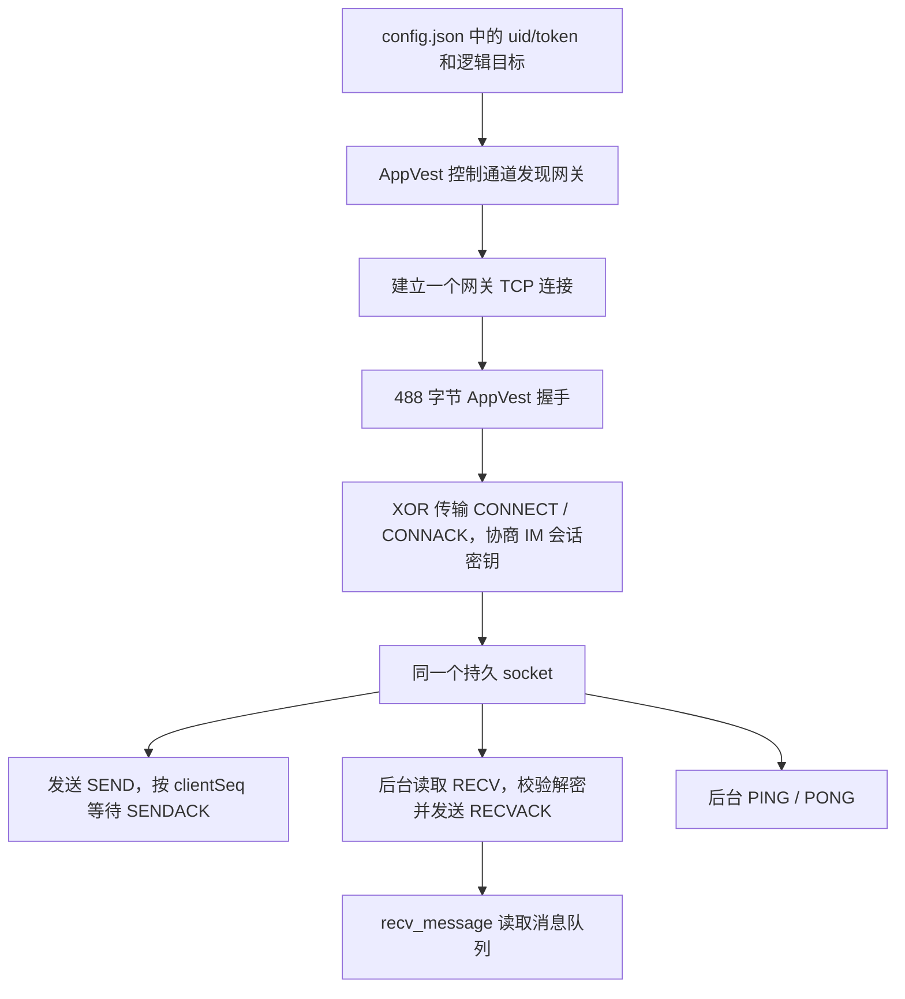

# 简讯 Socket 逆向与收发验证报告

日期：2026-10-19。结论：Python 客户端已通过 AppVest 网关连接 WuKongIM v4，
并完成测试群文本发送、第二账号接收解密、两个账号私聊双向收发。
每个客户端的发送、接收、回执和心跳共用一个持久 socket。

## 运行与结果

在项目根目录运行，复用当前 `config.json` 的 `uid/token`：

```powershell
python tools/im_probe.py --channel 9c509b80996e4ee8a1d315063c9b940a --channel-type 2 --text "Socket脚本测试：长连接、发送、接收已打通。验证标记 JX-SOCKET-1019" --out doc/ida_socket/live_group_script.json
```

该命令已经执行，退出码为 0，收到的 SENDACK 为：

```json
{
  "message_id": 2112165339868344320,
  "client_seq": 1,
  "message_seq": 15,
  "reason_code": 1
}
```

脚本还记录了 `connected=true`、`gateway=220.185.183.254:80`、
`send_succeeded=true` 和 `send_reason=Success`。这条消息的标记是
`JX-SOCKET-1019`；最新发送证明来自服务端回执，另一次群消息测试验证了第二账号接收。

| 验证项 | 证据文件 | 结果 |
|---|---|---|
| 最新脚本群发送 | [live_group_script.json](ida_socket/live_group_script.json) | SENDACK reason 1，群序号 15 |
| 第二账号接收群消息 | [live_group_message.json](ida_socket/live_group_message.json) | 消息 ID `2112161849800564736`，群序号 14，发送与接收 ID/序号相同，解密文本一致 |
| 私聊发送与回复 | [live_bidirectional.json](ida_socket/live_bidirectional.json) | 两方向内容一致，每个账号复用各自同一个 socket，收发后仍连接 |
| 默认配置连接 | [default_config_connection.json](ida_socket/default_config_connection.json) | AppVest / IM 连接成功 |
| 原生握手对照 | [native_handshake_verification.json](ida_socket/native_handshake_verification.json) | 原生返回 488，`wire_equal=true`，无明文字段差异 |

要等待新消息：

```powershell
python tools/im_probe.py --receive 60 --out doc/ida_socket/manual_receive.json
```

在等待期间用另一个账号发消息。`--receive` 等待一条任意通道的推送，成功后脚本退出；
超时返回非零退出码。库里的 `WKIMTimeout` 本身保留连接，脚本退出时由上下文管理器关闭。
可在同一条命令中同时使用 `--channel`、`--text`、`--receive 60`，验证同连接先发后收。

## 分析链路与修正

Flutter 的 `flutter_qlck` 插件通过 AppVest 将逻辑目标映射到数据网关。
真正构造网关首包、处理流量的库为 `resource/libcf-msc.so`。
IDA 导出的关键函数见 `doc/ida_cf/`，相应 Python 实现为 `jianxun/qlck.py`。



逻辑目标必须保持 `tcp.jianxun01.com:15100`。AppVest 的域名目标表使用完整的
`HOST:PORT`；将该目标替换为解析后的 IP 曾导致网关 EOF。
本次发现的网关包括 `220.185.183.254`、`117.149.203.233`、`117.149.203.234`，
数据端口为 80，调度控制通道端口为 8080。网关列表可能随网络和时间变化。

最初握手缺少启动计数、网络、会话 ID 和包名，网关在接受 TCP 后关闭。
补齐这些字段后，线上 CONNACK 和消息收发成功。

此前 README 对 7007 流的协议描述已更正。`cap_im4.pcap` 中对应 IM 的实际数据流为
`192.168.0.136:48710 ↔ 106.53.220.67:80`，首包后的字节与 `0x45` 异或后是
WuKongIM：PING `70`、PONG `80`、SEND 和成功 SENDACK。

### 原生函数证据

以下是本次 ARM64 样本的地址，其他版本需重新定位。

| 地址 | 作用 | 导出文件 |
|---|---|---|
| `0x26E7C0` | 构造 488 字节网关握手 | [0026e7c0.c](ida_cf/0026e7c0.c) |
| `0x26DEEC` | 网关连接首次发送握手 | [0026deec.c](ida_cf/0026deec.c) |
| `0x26DC40` | 后续传输逐字节 XOR | [0026dc40.c](ida_cf/0026dc40.c) |
| `0x26E424` / `0x2703D4` | 查找及写入 `HOST:PORT` 目标映射 | [0026e424.c](ida_cf/0026e424.c)、[002703d4.c](ida_cf/002703d4.c) |
| `0x26CDEC` | MurmurHash2，seed 0 | [0026cdec.c](ida_cf/0026cdec.c) |
| `0x26964C` / `0x269814` | 控制包封装与 AES | [0026964c.c](ida_cf/0026964c.c)、[00269814.c](ida_cf/00269814.c) |
| `0x26F874` / `0x26F8DC` | 首包 AES key 前缀与 IV | [0026f874.c](ida_cf/0026f874.c)、[0026f8dc.c](ida_cf/0026f8dc.c) |

### 握手与消息

网关首包：`cd6a000101e0 || nonce[2] || AES-CBC(plaintext[480])`。
AES key 为 `b"ce3487fe393c4f" + nonce`，IV 为 `b"1234567812345678"`。
后续流量的 XOR 值是本次握手设备指纹首字符的 ASCII 值。

| 明文偏移 | 长度 | 内容 |
|---|---|---|
| 0 / 1 | 各 1 | 协议 13 / 平台 2 |
| 2 | 2 | 域名目标模式下端口槽为 0 |
| 4 | 4 | API level，大端 |
| 16 | 4 | stream ID，小端 |
| 32 | 4 | 启动计数，小端 1 |
| 36 | 32 | AppVest app key |
| 68 | 32 | ASCII 设备指纹 |
| 100 / 116 / 132 | 15 / 15 / 31 | manufacturer / brand / model |
| 196 | 15 | 网络类型 `WIFI` |
| 212 | 16 | 会话随机 ID |
| 228 | 47 | 包名 `quya.app` |
| 276 | 64 | 逻辑目标 `tcp.jianxun01.com:15100` |
| 420 | 8 | SDK 标记 `20240525` |
| 436 | 4 | 目标字符串 MurmurHash2，大端 |
| 444 | 20 | SHA1(前 444 字节) |
| 464 | 16 | PKCS7 填充 `0x10` |

控制包为 16 字节掩码头、AES-CBC 数据和 20 字节 SHA1 尾。
实现校验头内 CRC32，支持 gzip 响应；`op=3` 请求得到 `op=259/status=200/ipset`。

IM CONNECT 使用现有 `uid/token` 与 X25519 客户端公钥；CONNACK 后导出会话密钥，
消息使用 AES-CBC / PKCS7 / Base64。SENDACK 的 `reason_code=1` 表示成功。
向自己发送曾返回 13（NotInWhitelist），不能将该返回当作消息成功。

## 实现与验证范围

`jianxun/im.py` 的后台线程独占读取，分别分发推送和发送回执；写入加锁，
发送请求按序等待 ACK。即使 RECV 先于 SENDACK 到达，也不会丢失或消费错误回执。
空闲时发送心跳。接收等待超时保留连接，发送回执超时不自动重发。

`main.py` 已接入 AppVest、文字发送和群历史/实时监听，离开群菜单时关闭连接。
运行 `python main.py`，选择群菜单第 5 项，输入最近历史条数（默认 20，0 跳过历史），
先显示历史，再持续打印当前群的新消息。先建 IM 连接再拉历史，重叠消息按 ID 去重。
按 Ctrl+C 返回群菜单，连接保留；历史请求超时仍继续监听。独立的监听脚本已移除。
`tools/im_probe.py` 独立读取配置，无需依赖 HTTP 群列表。
`config.json` 使用 `im_transport=appvest`；原账号、token 和设备配置保留。

复验命令：

```powershell
python -m unittest discover -s tests -v
python -m py_compile jianxun/im.py jianxun/qlck.py jianxun/config.py jianxun/__init__.py main.py tools/im_probe.py tools/analyze_im_capture.py tools/verify_qlck_native.py
python tools/verify_qlck_native.py
```

结果：11 项测试通过，语法编译通过；此前的 ARM64 原生握手字节对照通过。
本地 TCP 测试覆盖分帧与粘包、单连接并发收发、RECV 早于 SENDACK、
RECVACK、图片载荷、心跳和接收超时后保持连接。
抓包测试覆盖 TCP 重传、缺口与序号回绕、实际 SEND/ACK 及 8 个控制帧。
CLI 测试覆盖历史排序、历史/推送去重、其他群及私聊过滤、HTTP 超时后继续监听、
Ctrl+C 返回菜单，以及返回菜单后复用原连接继续发送。
`verify_qlck_native.py` 使用已安装的 Unicorn 和 pyelftools；生产客户端只需原有依赖
`requests`、`pycryptodome`。原生对照执行真实握手构造函数，外部摘要和 AES 调用由
确定性桩提供，验证的是构造字段及最终字节一致性。

线上实测范围是连接与文本收发；本次没有重新验证 HTTP 图片上传至图片送达的全流程。
执行期间 `/group/my` 曾超时，因此不据独立 IM 成功推断所有 HTTP 接口当前均可用。
未连接 Android 设备进行 UI 截图核对，最新群消息状态以服务端 SENDACK 为证。
报告不包含账号密码或会话 token。

## 2026-10-20 图片发送修复

原菜单仅按 JPEG 读取尺寸，PNG 得到 `0×0`；同时将 OSS 存储地址写入图片载荷。
线上群历史序号 20 复现了这两个字段差异，原 App 的正常图片消息具有正数宽高及
`file/preview/...` 路径。现改为识别 PNG/JPEG 的真实尺寸，使用上传返回的 `path`，
并在上传前拒绝无法读取尺寸的文件，IM 图片接口也拒绝非正数宽高。

通过真实 `main.py` 群菜单第 4 项发送 320×180 PNG：群序号 22，第二账号实时收到
相同尺寸及预览路径，预览接口 HTTP 200，下载字节与原图完全一致。
证据见 [live_image_send_20261020.json](ida_socket/live_image_send_20261020.json)。
未进行手机 UI 截图核对。新增 PNG/JPEG、无效图片及菜单路径回归测试后共 18 项通过。
